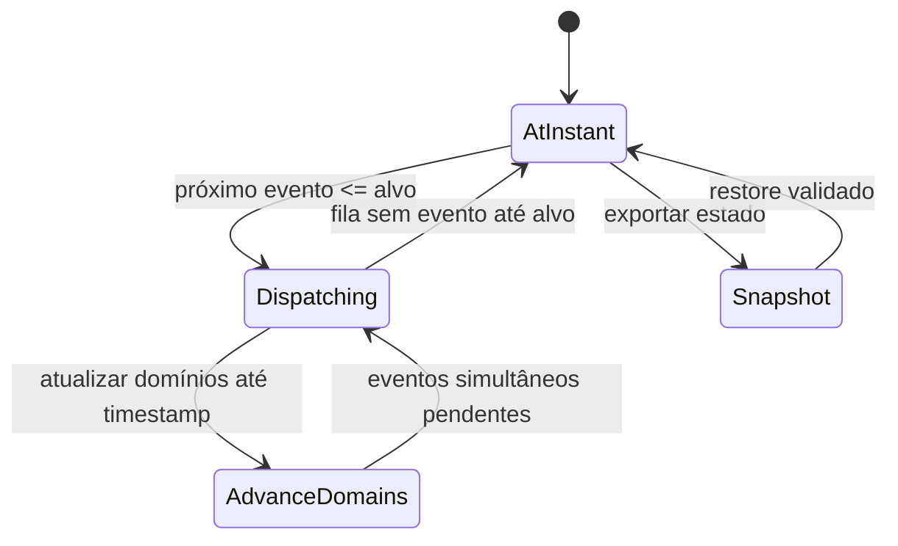
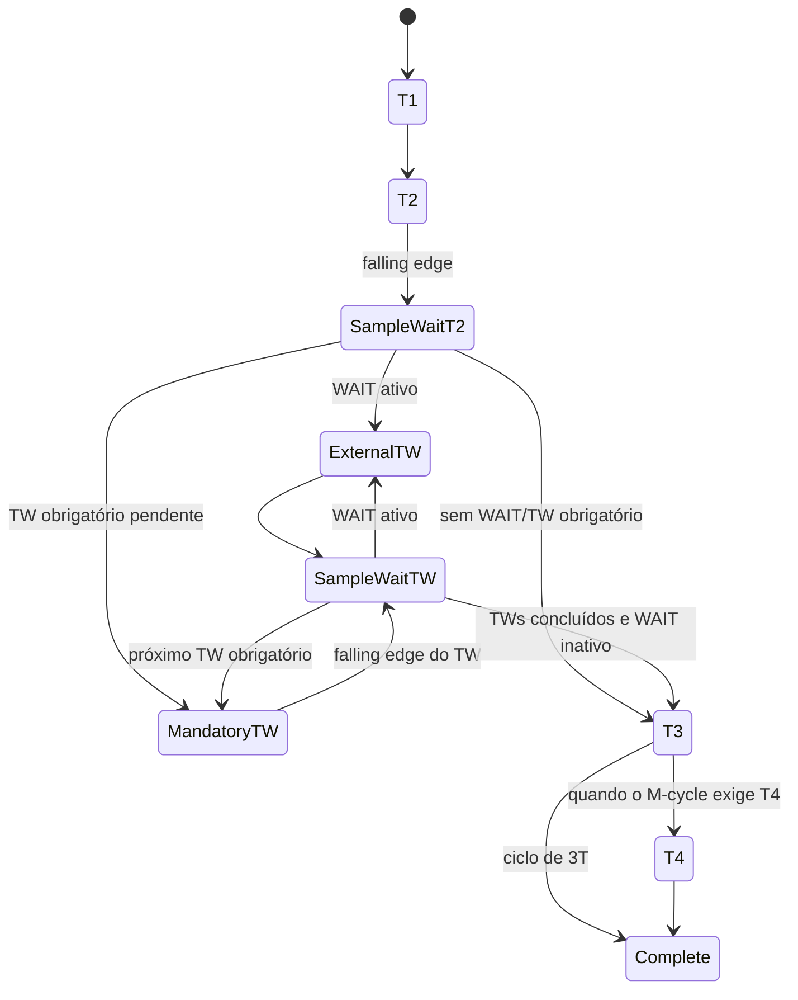
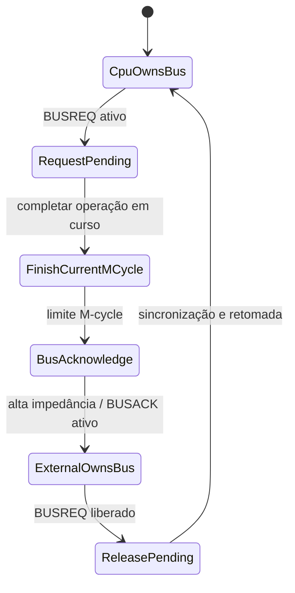

# E7 — Agente 3: consolidação e projeto semântico-temporal

**Data:** 2026-11-04  
**Baseline main:** `249d7a3da613dec456f22aa6a7ceaccb2418ee0b`  
**Entradas:** relatórios independentes dos Agentes 1 e 2; código remoto main e PRs #512, #514 e #526.  
**Status:** projeto de arquitetura para revisão. **Nenhuma implementação de hardware é aprovada por este documento.**

## 1. Síntese das evidências

### Concordâncias

- O Z80 deve avançar por M-cycles e T-states com operações de barramento explícitas.
- WAIT é uma amostra de sinal em fase elétrica específica, não uma duração genérica fornecida ao final de T-state.
- I/O e INT acknowledge possuem TWs automáticos tipados, além de WAIT externo.
- INT/NMI/EI/HALT exigem pontos de amostragem diferentes: fim de instrução, borda de NMI e T4 de ciclos HALT.
- BUSREQ/BUSACK requer conclusão do M-cycle, ownership externo e suspensão retomável.
- RETI é sinalização de fim de serviço periférico; RETN restaura IFF1 a partir de IFF2.
- O SMS VDP gera a linha INT e o Pause gera NMI; o Z80 compartilhado não deve duplicar lógica de console.
- Snapshot de registradores arquiteturais não é suficiente: é necessário serializar microsequência, barramento, waits, bordas e estado do Scheduler.

### Divergências/limites que permanecem explícitos

1. **WAIT em I/O:** o manual nomeia um TW automático entre T2 e T3 e a regra geral amostra WAIT em T2 e em cada TW. O contrato precisa usar borda/fase, não somente o rótulo T-state.
2. **WAIT durante waits mandatórios de INT:** o código da PR #512 consome waits mandatórios antes de consultar WAIT externo. Isso não comprova a amostragem externa em cada TW obrigatório. A forma de onda exata deve ser alinhada à Figura 9 antes de congelar a política de fila de TW.
3. **BUSREQ durante bordas/WAIT:** o manual define reconhecimento no último clock do M-cycle e alta impedância no clock seguinte; não define todos os casos de corrida com WAIT ativo no mesmo limite. Não inventar prioridade de subfase sem teste/diagrama adicional.
4. **NMI durante BUSACK:** o manual diz que a CPU não é interrompida durante BUSREQ e que BUSREQ supera NMI. O momento exato de serviço de uma borda NMI recebida durante DMA prolongado deve ser validado; preservar a pendência sem perder a borda.
5. **SMS status/line IRQ:** D7 do status $BF identifica VBlank; não usar esse bit como representação completa de pending line IRQ.

## 2. Diagnóstico da arquitetura C1

### 2.1 Estado da main

Na main `249d7a3...`:
- `MachineTime` é inteiro `u128`.
- `ClockEdgeTime` é um valor racional de preview, ainda com numerador/denominador `u64`.
- `ScheduledEvent.timestamp`, watermarks, `MachineScheduler.now` e snapshots de clock domains usam `MachineTime`.
- O codec do Scheduler serializa timestamps inteiros.
- O SMS temporal bus valida deadlines como múltiplos inteiros de `master_ticks_per_tstate`.

### 2.2 Estado candidato PR #526

A branch `feat/temporal-core-machine-instant-c1-clippy` já introduz:
- `MachineInstant` e `MachineDuration` com frações `u128);
- comparação racional por frações contínuas, sem cross multiplication;
- soma e diferença racional com checked arithmetic;
- timestamps racionais em `ScheduledEvent`, watermarks e EventQueue;
- codec scheduler schema v2 com timestamp racional para eventos.

Entretanto, a inspeção da branch demonstra que C1 ainda está incompleta:
- `MachineScheduler.now` permanece `MachineTime`;
- `ClockDomain.time`, `ClockDomainSnapshot.time`, `ClockDomainState.current_time` e `registration_start` permanecem inteiros;
- o Scheduler ainda converte o evento para timestamp integral no dispatch;
- `SubTickEventUnsupported` continua presente;
- a geração/avanço de clock domains ainda não é dirigida por `MachineInstant`;
- os consumidores SMS/SG-1000 ainda usam deadlines inteiros;
- falling/rising edges não existem como eventos persistidos.

### 2.3 Falha matemática concreta na soma racional

A soma atual usa denominador comum por LCM em `u128` e retorna `ArithmeticOverflow` antes da redução final. Há casos em que o LCM não cabe em `u128`, mas a fração resultante reduz-se a um valor representável.

Contraexemplo reproduzível:

```text
g = 68056473384187692692674921486353642281
a = 2*g
b = 3*g
n1 = 1
n2 = (g - 3) / 2

1/(2g) + ((g-3)/2)/(3g)
= [3 + (g-3)]/(6g)
= g/(6g)
= 1/6
```

Propriedades:
- `2g` e `3g` são denominadores positivos representáveis em `u128`;
- as duas frações estão reduzidas;
- `6g > u128::MAX`, portanto o LCM intermediário não cabe em `u128`;
- o resultado final `1/6` é perfeitamente representável.

**Conclusão:** o teste atual de overflow pode rejeitar uma operação cujo resultado canônico cabe. Antes de aceitar C1, a soma/subtração deve reduzir com intermediários suficientemente largos (por exemplo, inteiro multiprecisão ou implementação própria de 257 bits com provas/limites) e só então verificar se o resultado final cabe nos campos públicos. A comparação por frações contínuas é apropriada; a soma atual não fecha esse requisito.

## 3. Decisões arquiteturais propostas

### D1 — Um único instante absoluto

Promover `MachineInstant` a unidade de todo timestamp absoluto. `MachineTime` pode permanecer como unidade/duração inteira de compatibilidade, mas não pode ser usado para armazenar um instante de Scheduler, clock domain, evento, watermark ou snapshot.

Proibido:
- conversão implícita que descarte a fração;
- clock paralelo por console;
- uso de `HardwarePhase` como substituto de sub-tick;
- ponto flutuante.

### D2 — Duração distinta de instante

Manter `MachineDuration` dimensionalmente separado de `MachineInstant`. Não aceitar `MachineInstant + MachineInstant`. Toda operação deve ser checked e atômica em erro.

### D3 — ClockDomain dirigido por instante racional

A razão de clock continua racional `cycles_numerator/ticks_denominator`. O domínio deve:
- avançar para `MachineInstant`;
- reter resto/fase exatos;
- calcular próximas bordas sem arredondamento;
- permitir múltiplas bordas em uma janela;
- preservar registration origin, initial phase, current instant, total cycles e remainder no snapshot;
- garantir equivalência entre avanço único e avanço particionado.

### D4 — Fases elétricas são eventos temporais

Criar tipo explícito `ClockEdgePolarity::{Falling, Rising}`. A polaridade não é prioridade de software e não deve ser embutida em booleanos genéricos. Cada transição tem timestamp racional exato e ordinal de clock local.

O Scheduler ordena por:
1. `MachineInstant`;
2. ordem de fase/evento de hardware explicitamente definida pelo perfil;
3. prioridade de despacho do perfil;
4. sequência monotônica estável.

A polaridade identifica o evento físico; não usar um `HardwarePhase` ordinal para fingir que falling/rising têm distância temporal.

### D5 — Waits tipados por origem

Usar `WaitOrigin::{External, AutomaticIo, AutomaticInterruptAcknowledge}`. Não manter apenas `fixed_wait_tstates: u32`. O estado precisa identificar:
- qual TW está sendo executado;
- quantos TWs mandatórios ainda restam;
- quantos TWs externos foram inseridos;
- se a amostra WAIT já ocorreu nesta fase;
- valor de WAIT observado;
- próxima fase elétrica;
- posição do M-cycle.

### D6 — Barramento como ownership explícito

BUSREQ/BUSACK não é apenas um booleano de CPU. Modelar:
`BusOwnership::{Cpu, RequestPending, BusAcknowledged, ExternalOwner}`
ou equivalente com tipos que impeçam combinações inválidas. A CPU só volta a emitir transações após o ciclo de liberação/retomada definido pelo contrato.

### D7 — RETI como evento de dispositivo

A execução de RETI deve produzir evento semântico explícito para o sistema de periféricos. O estado IFF1/IFF2 não deve ser alterado como se RETI fosse RETN.

### D8 — VDP como produtor de linha

O VDP SMS mantém seus próprios estados de frame pending, line pending, enables e status. A saída INT é derivada desses estados e é conectada ao pino de entrada do Z80 compartilhado. A leitura do status $BF é operação com side effect no VDP.

## 4. Modelo de estados

### 4.1 Timeline e Scheduler



Transições proibidas:
- avanço para instante anterior ao `now`;
- despacho de evento com chave menor que watermark;
- truncar timestamp racional em API integral;
- restaurar domínio cuja história aritmética não fecha.

### 4.2 M-cycle / WAIT



O diagrama é uma máquina de estados de projeto, não afirma que todos os M-cycles possuem T4. O número de T-states nominais depende do tipo de M-cycle. Para M1/acknowledge, os estados adicionais e refresh devem ser explicitados no perfil do ciclo.

**Ponto pendente:** o sequenciamento exato entre TW obrigatório e TW externo no acknowledge INT precisa ser confrontado com a Figura 9 e validado por trace. A regra invariável é que a entrada WAIT seja amostrada nas falling edges aplicáveis de T2 e de cada TW, sem ser ignorada por existir TW obrigatório.

### 4.3 BUSREQ/BUSACK (somente após C1–C6)



O instante exato entre amostra BUSREQ, alta impedância e BUSACK deve seguir a Figura 8; o diagrama não pretende substituir essa forma de onda.

### 4.4 Interrupções

- `NmiEdgePending`: captura a borda negativa de NMI e retém o pedido.
- `IntLevelPending`: reflete a linha INT ativa.
- `InterruptEligibility`: verifica IFF1, EI delay, BUSREQ/BUSACK e boundary de instrução.
- `HaltT4Sample`: amostra INT/NMI em cada T4 de retenção.
- `InterruptAcknowledge`: ciclo M1 especial com IORQ, vetor e TWs mandatórios.

Não fundir NMI edge e INT level num único booleano.

## 5. Contratos Rust propostos

Pseudotipos (nomes provisórios; revisão de API antes da implementação):

```rust
#[derive(Clone, Copy, Debug, Eq, PartialEq)]
pub enum ClockEdgePolarity {
    Falling,
    Rising,
}

#[derive(Clone, Copy, Debug, Eq, PartialEq)]
pub struct ClockEdge {
    pub instant: MachineInstant,
    pub domain: ClockDomainId,
    pub cycle_index: u128,
    pub polarity: ClockEdgePolarity,
}

#[derive(Clone, Copy, Debug, Eq, PartialEq)]
pub enum WaitOrigin {
    External,
    AutomaticIo,
    AutomaticInterruptAcknowledge,
}

#[derive(Clone, Copy, Debug, Eq, PartialEq)]
pub enum Z80McyclePhase {
    T1,
    T2,
    Wait { origin: WaitOrigin, ordinal: u32 },
    T3,
    T4,
    Complete,
}

#[derive(Clone, Copy, Debug, Eq, PartialEq)]
pub struct WaitSample {
    pub instant: MachineInstant,
    pub polarity: ClockEdgePolarity,
    pub mcycle: MCycleIndex,
    pub phase: Z80McyclePhase,
    pub wait_asserted: bool,
}

#[derive(Clone, Debug, Eq, PartialEq)]
pub enum BusOwnership {
    Cpu,
    RequestPending { since: MachineInstant },
    ExternalOwner { since: MachineInstant },
    ReleasePending { since: MachineInstant },
}
```

Invariantes:
- `ClockEdge.instant` nunca retrocede no mesmo domínio.
- Uma amostra WAIT é válida somente em falling edge designada.
- Uma amostra só pode ocorrer uma vez por fase/ordinal.
- Cada TW tem origem e ordinal estáveis.
- Operações de barramento têm commit uma única vez, na fase de commit definida.
- BUSACK implica barramento indisponível à CPU.
- Estado de `ExternalOwner` não pode conter transação CPU em andamento que ainda emita pinos.
- Snapshot restaura a próxima transição exata, sem repetir uma amostra ou commit.

## 6. Pseudocódigo de transições

### Avanço de um edge

```text
advance_to_next_edge(domain):
    edge = domain.next_edge()
    scheduler.advance_all_domains_to(edge.instant)
    dispatch all events ordered at edge.instant
    persist edge polarity and local edge ordinal
    return edge
```

### WAIT

```text
on falling_edge(T2 or TW):
    sample = read WAIT line at this exact instant
    store WaitSample in continuation
    if sample.asserted:
        schedule one external TW before the next nominal T-state
    else:
        continue mandatory TW queue or advance to T3
```

A política de TW obrigatório do INT acknowledge deve preservar os dois TW automáticos mesmo se WAIT externo for observado; o TW adicional nunca substitui um TW mandatório.

### BUSREQ

```text
on documented final rising edge of current M-cycle:
    if BUSREQ is active:
        mark request accepted
        schedule bus lines high-impedance on following rising edge
        assert BUSACK when the pin contract says bus is available
        suspend CPU bus issue; preserve continuation
```

### RETI

```text
execute ED 4D / documented RETI aliases:
    perform return stack reads and PC update
    emit RetireInterruptService event at defined semantic point
    daisy-chain device updates in-service state
```

O ponto exato do evento deve ser definido contra o diagrama/semântica do periférico utilizado; não emitir RETI na simples decodificação do prefixo ED.

## 7. Plano de serialização

### C1 — Scheduler
- `MachineInstant now`;
- clock domains: razão, registration origin, initial phase, current instant, total cycles, fractional remainder;
- EventQueue: eventos com timestamp racional, phase, priority, sequence;
- watermark racional e última chave despachada;
- dispatch counters e política delta-event;
- codec schema com campos racionais canônicos.

### C2 — Edge state
- próximo ordinal de borda local;
- polaridade/estado de fase;
- instante da próxima borda;
- razão de clock e fase inicial;
- nenhum valor derivado deve substituir a fonte de verdade se sua reconstrução não for matematicamente única.

### C3 — M-cycle
- tipo M-cycle e tamanho nominal;
- índice T nominal concluído;
- fase elétrica atual;
- waits mandatórios restantes por origem;
- waits externos inseridos;
- amostras WAIT e valor observado;
- request ID, endereço, direção, dados latched;
- fase de commit/acknowledge;
- resultado de barramento já latched e se foi reconhecido pelo consumidor.

### E7.4–E7.6
- ownership de barramento e BUSREQ/BUSACK;
- NMI edge pending, INT level, IFF1/IFF2, EI delay e HALT;
- estado do dispositivo daisy-chain (INT/IUS/IEO e prioridade);
- estado VDP: flags de frame/line, enables, contador R10 e linha INT resultante.

A restauração deve validar invariantes e rejeitar combinações impossíveis, nunca “corrigir” o estado silenciosamente.

## 8. Plano de testes e gates

### C1
- normalização, igualdade e ordenação racional;
- soma/subtração com carry/borrow e denominadores coprimos;
- contraexemplo LCM overflow com resultado reduzido representável;
- overflow final verdadeiro;
- aritmética atômica em erro;
- eventos com mesma parte inteira em frações distintas;
- watermark racional;
- clock ratios 7/3, 3/2, 5/7 e denominadores não relacionados;
- avanço contínuo versus chunks aleatórios determinísticos;
- snapshots/codec round-trip, rejeição de versões e frações não canônicas.

### C2/C3
- WAIT muda imediatamente antes, exatamente na e imediatamente depois da falling edge T2;
- WAIT ativo em cada TW e liberado em TW intermediário;
- I/O automático TW + WAIT externo;
- INT acknowledge com dois TW mandatórios e WAIT externo;
- WAIT em M1, memória, I/O, acknowledge e HALT;
- snapshot em falling edge, rising edge, antes/depois de sample e antes/depois de commit;
- comparação de traces completos contínuo versus blocos.

### E7.4–E7.6
- BUSREQ em cada fase de M-cycle, durante WAIT, no limite de M-cycle e durante BUSACK;
- DMA de duração variável, liberação e retomada;
- INT/NMI durante request/acknowledge/ownership externo;
- RETI com múltiplos periféricos em cadeia e prioridade aninhada;
- VBlank e line IRQ independentes, enable/disable, leitura de status e acknowledge.

### Classificação obrigatória
Cada suíte deve ter PASS/FAIL/BLOCKED/NOT RUN. CI convencional não promove LONG_PASS, DIFFERENTIAL_PASS ou TEMPORAL_PASS.

## 9. Critérios de aceitação da modelagem

1. Uma timeline racional é a única fonte de verdade para todos os consoles.
2. `MachineScheduler.now`, ClockDomain, EventQueue, watermarks, snapshots e codec compartilham MachineInstant.
3. Nenhum sub-tick é rejeitado ou truncado.
4. Aritmética racional só retorna overflow quando o resultado final não cabe, não por intermediário evitável.
5. Falling/rising edge têm instantes distintos e exatos, inclusive clocks ímpares.
6. WAIT é amostrado nas falling edges documentadas.
7. I/O e INT ack têm TWs mandatórios tipados e amostragem WAIT externa aplicável.
8. Todo estado de continuação pode ser salvo/restaurado sem repetir efeitos.
9. BUSREQ/BUSACK só começa após C1–C6.
10. RETI/daisy-chain e VDP IRQ permanecem etapas E7 separadas.
11. Nenhuma família de opcode é declarada completa por dispatch ou aceitação de opcode.
12. E8 só inicia após auditoria formal de E7.7 e integração final aprovada.

## 10. Ordem de implementação recomendada

1. **C1.1:** completar `MachineInstant` e `MachineDuration` com aritmética exata que não rejeite resultados representáveis por overflow intermediário.
2. **C1.2:** migrar `ClockDomain`, snapshots e validação de história para instantes racionais.
3. **C1.3:** migrar `MachineScheduler.now`, avanço e dispatch para MachineInstant; eliminar `SubTickEventUnsupported` somente após todos os caminhos estarem racionais.
4. **C1.4:** migrar consumidores SMS e SG-1000, snapshots e codec; atualizar schema e testes de migração/rejeição.
5. **C1.5:** provar chunk invariance e determinismo end-to-end.
6. **C2:** implementar falling/rising edge como eventos explícitos.
7. **C3:** corrigir TW automático e WAIT sample por origem/fase.
8. **C4–C6:** integrar Z80/SMS, snapshots e validação temporal.
9. Só então E7.4 BUSREQ/BUSACK, E7.5 RETI, E7.6 VDP IRQ e E7.7 auditoria integral.

## 11. Riscos e limitações

- `u128` para numerador/denominador não garante que soma racional possa ser calculada com intermediários `u128`; há contraexemplo explícito neste documento.
- Introduzir big integer externo pode alterar lockfiles e suporte offline; uma implementação própria precisa de provas/testes de aritmética.
- O scheduler deve definir como eventos simultâneos em um mesmo MachineInstant interagem sem usar prioridade como substituto de tempo.
- O contrato de M-cycle ainda não determina todos os pontos de commit de barramento para todos os opcodes; a matriz semântica continua necessária.
- O comportamento de BUSREQ/NMI durante DMA e o interleaving exato de waits mandatórios/externos precisam de trace de referência adicional.
- A linha IRQ do SMS VDP e status read têm efeitos colaterais; não reduzir a uma flag genérica no Z80.

## 12. Resultado do Agente 3

**Decisão:** C1 continua sendo o bloqueio estrutural atual. PR #526 é uma candidata parcial e não está pronta para merge: o Scheduler/ClockDomain ainda retêm tempo inteiro, a rejeição de sub-tick permanece e a soma racional possui falso overflow em resultado reduzível. PRs #512 e #514 não devem ser integradas isoladamente enquanto o contrato temporal e WAIT/TW não estiverem completos.

**Implementação:** não iniciada neste relatório. A etapa de modelagem é apresentada para revisão antes de alterar o runtime.
